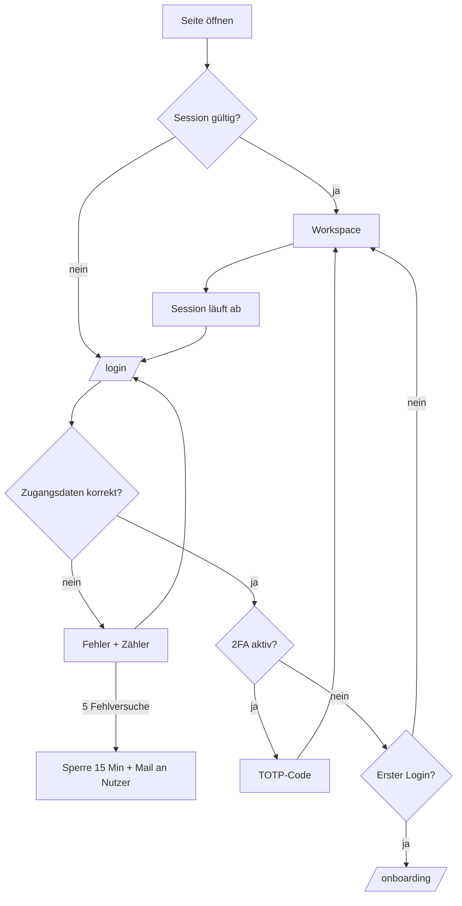
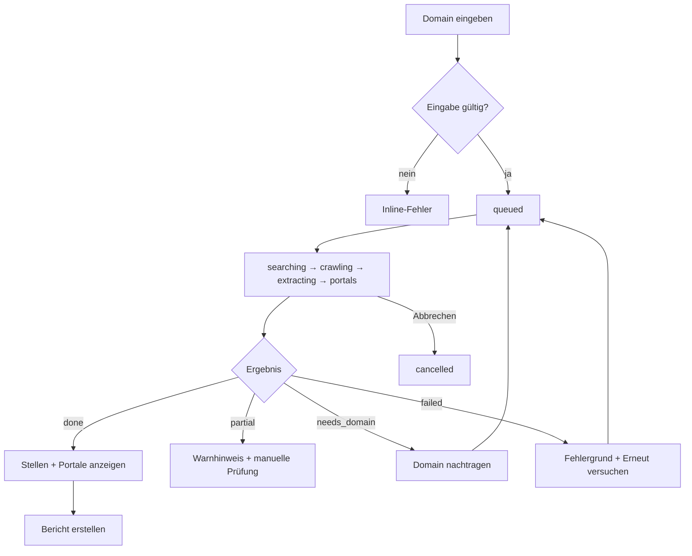
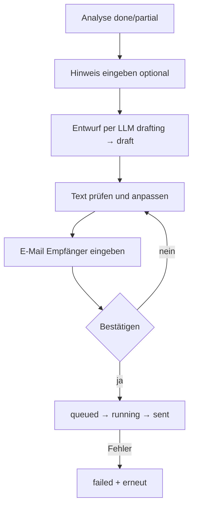

> Worked example: output of the `unslop-flows` skill on a real job-discovery app. Internal paths and hosts removed.

# Jobfinder – App-Flows & fehlende Features

**Stand:** 2026-11-09 · **Basis:** Code-Review einer React/Vite + FastAPI + SQLite App hinter einem Reverse Proxy

---

## 1. Ist-Zustand in 60 Sekunden

Eine einzige Seite (`App.jsx`, ~1000 Zeilen), kein Router.

| Bereich | Heute |
|---|---|
| Einstieg | Domain-Feld oben → `POST /api/analyze` |
| Liste | Linke Rail „Analysen“ mit Suche, live per SSE |
| Ergebnis | ResultCard: Trace (Domain → Karriere → Stellen), Timeline, Portal-Rail, Stellen-Tabelle |
| Bericht | `ReportPanel`: Entwurf per LLM → Text anpassen → E-Mail-Adresse → senden (Resend) |
| Aktionen | Abbrechen, Neu analysieren, Erneut versuchen, Domain nachtragen, Löschen |
| Fehler | Banner bei `health.ok=false`, Toasts, Klartext-Fehlerboxen |
| Daten | `companies`, `links`, `jobs`, `events`, `company_meta`, `reports`. **Keine** `users`-Tabelle |

**Kernlücke:** Es gibt keine Identität. Alle Analysen gehören „allen Nutzern“ (Bestätigungstext beim Löschen: „für alle Nutzer“). Ein Login existiert nur als **auskommentierte Traefik-BasicAuth** in `docker-compose.yml`; `X-Forwarded-User` wird im Backend nicht gelesen.

---

## 2. Rollen (Zielbild)

| Rolle | Darf |
|---|---|
| **Gast** | Login-/Reset-Seiten sehen, Einladung annehmen |
| **Nutzer (Vertrieb/Recruiting)** | Eigene Analysen starten, Berichte erstellen und senden, eigene Einstellungen |
| **Team-Admin** | Nutzer einladen/sperren, Team-Vorlagen und Absender, alle Analysen des Teams, Limits |
| **System-Admin (Betreiber)** | Provider-Keys, Health, Logs, Mandanten, Abrechnung |

Entscheidung nötig: Single-Tenant (nur das eigene Team) oder Multi-Tenant (Kunden). Siehe Abschnitt 10.

---

## 3. Screen-Landkarte

```
/login                  Anmelden
/forgot  /reset/:token  Passwort vergessen / neu setzen
/invite/:token          Einladung annehmen (Passwort setzen)
/onboarding             Erststart-Assistent (3–4 Schritte)
/                       Workspace (heutige App): Rail + Domain-Start + Ergebnis
/a/:id                  Deep-Link auf eine Analyse (teilbar)
/batch                  Mehrere Domains / CSV analysieren
/reports                Berichte: Entwürfe, gesendet, Fehler
/settings/profile       Name, E-Mail, Passwort, 2FA, Sprache
/settings/team          Mitglieder, Rollen, Einladungen
/settings/mail          Absender, Signatur, CC, Vorlagen
/settings/analysis      Portale, Limits, Standardwerte
/settings/notifications Benachrichtigungen
/settings/api           API-Keys, Webhooks
/settings/billing       Plan, Nutzung (nur bei Multi-Tenant)
/admin/system           Health, Queue, Provider, Logs
/help                   Hilfe, Statuserklärungen, Support
/legal/*                Impressum, Datenschutz, AGB
404 · 403 · 500 · Offline
```

---

## 4. Flows

### 4.1 Login & Session



**Soll:** E-Mail + Passwort (alternativ Magic Link), „Angemeldet bleiben“, Logout, Session-Timeout mit Rücksprung auf die zuletzt offene URL, Rate-Limit pro IP + Konto, generische Fehlermeldung (kein „E-Mail unbekannt“).

### 4.2 Passwort vergessen / Einladung

1. `/forgot` → E-Mail eingeben → immer dieselbe Bestätigung („Falls das Konto existiert …“).
2. Mail mit Einmal-Link (60 Min gültig, einmal nutzbar) → `/reset/:token` → neues Passwort (Stärke-Anzeige) → automatisch eingeloggt, alle anderen Sessions beendet.
3. **Einladung:** Admin trägt E-Mail + Rolle ein → Mail → `/invite/:token` → Name + Passwort → Onboarding.
4. Abgelaufener/benutzter Link → eigene Fehlerseite mit „Neuen Link anfordern“.

### 4.3 Onboarding (Erststart)

| Schritt | Inhalt | Überspringbar |
|---|---|---|
| 1 Willkommen | Was der Jobfinder tut, 3-Zeilen-Erklärung des Ablaufs | nein |
| 2 Absender | Name, Firma, Signatur, Antwort-Adresse für Berichte | ja (später in Settings) |
| 3 Portale | Welche Jobportale geprüft werden sollen (Default: alle) | ja |
| 4 Erste Analyse | Beispiel-Domain vorbefüllt, Live-Lauf als Demo | ja |
| Ende | Checkliste „Erste Analyse · Bericht erstellt · Kollege eingeladen“ im Workspace | – |

Zusätzlich: Leerzustand im Workspace mit Beispiel-Domain-Chips, Produkt-Tour (3 Tooltips: Domain-Feld, Rail, Bericht).

### 4.4 Kern-Flow: Analyse (existiert, mit Lücken)



**Lücken:** kein Deep-Link auf eine Analyse, keine Zuordnung zum Nutzer, kein Export (CSV/PDF), keine Wiederholung nach Zeitplan, keine Vergleichsansicht „was hat sich seit der letzten Analyse geändert“, kein Batch.

### 4.5 Bericht erstellen & senden (existiert, mit Lücken)



**Lücken:** kein Vorschau-/Testversand an sich selbst, kein Absender pro Nutzer, keine Vorlagen, keine Anhänge/PDF, keine Versandhistorie über alle Firmen, kein Tracking (geöffnet/geklickt), keine Abmelde-/Widerspruchsfunktion, keine Dublettenwarnung („Dieser Empfänger hat schon am … einen Bericht erhalten“), keine Rückmeldung bei Bounce.

### 4.6 Batch-Analyse

CSV/Liste einfügen (Firma, Domain) → Vorschau mit Dubletten- und Fehlerprüfung → Start → Fortschrittsbalken „12 von 40“ → Sammelergebnis mit Export. Nutzt `POST /api/companies` + `enqueue`; Queue-Limit aus `WORKER_CONCURRENCY` sichtbar machen.

### 4.7 Settings

Siehe Abschnitt 5. Jede Settings-Seite: Änderungen mit „Speichern“ + Erfolgs-Toast, ungespeicherte Änderungen warnen, sensible Änderungen (Passwort, E-Mail, 2FA) verlangen erneute Passworteingabe.

### 4.8 Konto löschen / Daten exportieren (DSGVO)

Settings → „Meine Daten exportieren“ (ZIP/JSON) · „Konto löschen“ mit Passwort-Bestätigung → 14 Tage Wartefrist → endgültig; Analysen wahlweise an Team-Admin übertragen.

### 4.9 Fehler- und Randzustände

| Zustand | Heute | Soll |
|---|---|---|
| Crawler/Token down | rotes Banner | + Status-Link, Auto-Retry-Hinweis |
| SSE getrennt | stilles Reconnect | dezenter „Live-Verbindung getrennt“-Hinweis |
| Offline | – | Offline-Seite |
| Session abgelaufen | – | Modal „Bitte neu anmelden“ ohne Datenverlust |
| 404 / 403 / 500 | SPA-Fallback liefert `index.html` | eigene Seiten |
| Limit erreicht | – | klare Meldung + Hinweis an Admin |
| E-Mail-Versand nicht konfiguriert | Hinweistext im Panel | Admin-Hinweis mit Link zu Settings |

---

## 5. Settings im Detail

| Bereich | Felder / Funktionen | Status |
|---|---|---|
| **Profil** | Name, E-Mail ändern (mit Verifizierung), Passwort ändern, 2FA (TOTP), aktive Sitzungen beenden, Sprache, Zeitzone | fehlt |
| **Team** | Mitglieder, Rollen, Einladungen versenden/zurückziehen, Nutzer sperren | fehlt |
| **Mail** | Absendername, Reply-To, CC-Standard (`REPORT_CC` aktuell nur ENV), Signatur, Betreff-/Text-Vorlagen, Testversand | fehlt (nur ENV) |
| **Analyse** | Portal-Auswahl (`JOB_PORTALS` aktuell ENV), Standard-Tiefe, max. Seiten, Timeout, Wiederholung/Zeitplan | fehlt (nur ENV) |
| **Bericht-KI** | Tonalität, Sprache, Schwerpunkte, eigene Prompt-Bausteine, Modellwahl (Admin) | fehlt |
| **Benachrichtigungen** | Mail/Push wenn Analyse fertig, Bericht gesendet/fehlgeschlagen, Wochenübersicht | fehlt |
| **API & Webhooks** | API-Keys, Webhook bei `done`/`failed`/`sent`, CRM-Anbindung (z. B. Pipedrive) | fehlt |
| **Billing/Limits** | Plan, Analysen pro Monat, Berichte pro Monat | nur bei Multi-Tenant |
| **Darstellung** | Hell/Dunkel, Dichte, Barrierefreiheit (reduzierte Animation wird bereits respektiert) | fehlt |

---

## 6. Fehlende Features – nach Themen

### 6.1 Zugang & Sicherheit (Blocker)
- Login, Session, Logout, Passwort-Reset, Einladung (Abschnitt 4.1–4.2)
- Rollen/Rechte im Backend erzwingen, nicht nur im UI
- `user_id` an `companies` und `reports`; Löschen nur für Eigentümer/Admin
- Rate-Limits auf `/api/analyze` und `/api/*/report/*/send` (Missbrauch = Mail-Spam und Crawler-Last)
- CSRF-Schutz bei Cookie-Sessions, Security-Header, `Secure`/`HttpOnly`-Cookies
- Audit-Log: wer hat wann analysiert/gesendet/gelöscht
- **`/api/*` ist aktuell ohne Auth erreichbar**, sobald BasicAuth nicht aktiv ist. Die Compose-Datei hat nur auskommentierte Zeilen. Vor dem ersten externen Nutzer klären.

### 6.2 Onboarding & Hilfe
- Assistent (4.3), Leerzustände, Beispiel-Domains
- Statuserklärung („Was heißt ‚unvollständig‘?“) direkt am Badge
- Hilfeseite + Kontakt-/Support-Link (Fehlertexte verweisen auf „den Support“, es gibt aber keinen)
- Changelog / „Neu“-Hinweis

### 6.3 Analyse-Funktionen
- Deep-Link `/a/:id`, Teilen-Link (nur lesend)
- Export: CSV der Stellen, PDF des Ergebnisses
- Batch (4.6), geplante Wiederholung (z. B. wöchentlich), Änderungsvergleich
- Filter/Sortierung der Liste (Status, Datum, Nutzer, Stellenzahl), Pagination (heute lädt die UI **jede** Firma einzeln per `api.get` bei jedem Refresh)
- Manuelle Korrektur: Karriere-URL setzen, Stelle ausblenden, Notiz zur Firma
- Tags/Kunden-Zuordnung, Favoriten

### 6.4 Bericht & Mail
- Vorlagen, Testversand, Vorschau HTML, PDF-Anhang
- Versandhistorie (Seite `/reports`), Dublettenwarnung, Bounce-/Zustellstatus (Resend-Webhooks)
- Rechtliches: Absenderangabe, Hinweis zur Datenherkunft, Abmeldelink bzw. Sperrliste (Kaltakquise per Mail: Rechtslage vorab klären)

### 6.5 Betrieb
- Admin-Seite: Queue-Länge, laufende Jobs, Crawl4AI/FlareSolverr/SearXNG-Status, letzte Fehler
- Backups für das SQLite-Volume `jobfinder_data`, Migrationen versioniert (aktuell `_check_cols`)
- Monitoring/Alerts, Fehler-Tracking, Produkt-Tracking der Kernereignisse
- **Gate G8 (Live-Deployment) ist in `GATES.md` noch offen**
- SQLite → Postgres, sobald mehrere Nutzer parallel schreiben

### 6.6 Rechtliches
- Impressum, Datenschutz, AV-Vertrag (bei Mandanten), Cookie-Hinweis (nur bei Tracking), Löschkonzept für Empfänger-Adressen und Berichtstexte

---

## 7. Datenmodell-Erweiterungen

```
users(id, email, name, password_hash, role, team_id, totp_secret, locale, created_at, last_login_at, disabled_at)
teams(id, name, mail_from_name, mail_reply_to, mail_cc, signature_md, created_at)
sessions(id, user_id, created_at, expires_at, ip, user_agent)
invites(id, team_id, email, role, token_hash, expires_at, used_at)
password_resets(id, user_id, token_hash, expires_at, used_at)
user_settings(user_id, key, value)
team_settings(team_id, key, value)             -- Portale, Limits, Defaults
report_templates(id, team_id, name, subject, body_md)
api_keys(id, team_id, name, key_hash, last_used_at, revoked_at)
webhooks(id, team_id, url, events, secret)
audit_log(id, user_id, action, entity, entity_id, ts, meta)
companies  += owner_id, team_id, tags, notes, schedule
reports    += created_by, template_id, delivered_at, bounced_at
```

## 8. API-Erweiterungen

| Bereich | Endpunkte |
|---|---|
| Auth | `POST /api/auth/login` · `/logout` · `/forgot` · `/reset` · `/invite/accept` · `GET /api/me` · `POST /api/me/2fa` |
| Settings | `GET/PUT /api/settings/{profile,mail,analysis,notifications}` |
| Team | `GET/POST/DELETE /api/team/members` · `/api/team/invites` |
| Analyse | `GET /api/companies?status=&q=&page=` · `POST /api/batch` · `GET /api/companies/{id}/export.csv` |
| Berichte | `GET /api/reports` · `POST /api/reports/test-send` · `GET/POST /api/report-templates` |
| Admin | `GET /api/admin/queue` · `/admin/providers` · `/admin/audit` |
| Integrationen | `POST /api/webhooks` · `POST /api/keys` · Resend-Webhook-Empfang |

---

## 9. Priorisierung

| Stufe | Umfang | Warum |
|---|---|---|
| **MVP (vor externer Nutzung)** | Login/Logout/Reset/Einladung, `users` + Eigentümer an Analysen, Rate-Limits, Profil-Settings, Mail-Absender-Settings, Fehlerseiten, Impressum/Datenschutz | Ohne Identität kein Zugriffsschutz, keine Verantwortung für versendete Mails |
| **V1** | Onboarding-Assistent, Deep-Link, Berichte-Übersicht, Testversand, Vorlagen, Export CSV, Paginierung/Filter, Admin-System-Seite, Benachrichtigungen | Alltagstauglichkeit und Betrieb |
| **V2** | Batch, geplante Wiederholung + Änderungsvergleich, 2FA, API-Keys/Webhooks, CRM-Anbindung, PDF-Bericht, Mandantenfähigkeit/Billing | Wachstum und Integration |

## 10. Offene Entscheidungen

1. **Single- oder Multi-Tenant?** Nur das eigene Team oder auch Kunden? (bestimmt Billing, Mandantentrennung, AV-Vertrag)
2. **Auth-Weg:** eigene Benutzerverwaltung im Backend, oder zentraler Login (z. B. Traefik-Forward-Auth / OzFlow-SSO)? Zentral spart Aufwand, wenn OzFlow/Masterdatenbank denselben Login nutzen sollen.
3. **Mail-Rechtslage:** Dürfen Berichte an Erstkontakte gehen (UWG/DSGVO)? Davon hängen Abmeldelink und Sperrliste ab.
4. **DB:** SQLite beibehalten oder jetzt auf Postgres?
5. **Wer ist „Support“?** Die Fehlertexte verweisen darauf – Kontaktweg festlegen.
6. **Verhältnis zu Schwestersystemen:** Sollen Daten in ein zentrales System fließen, und kann dessen Login mitgenutzt werden?

---

*Hinweis: Beispiel-Output von `unslop-flows` auf einer realen App (Stand 9. Nov. 2026). Gelesen wurden README, Gates, Compose-Datei, `frontend/src/App.jsx` (Shell, ResultCard, ReportPanel), `backend/app/main.py` (Routen) und `backend/app/db.py` (Schema). Nicht geprüft: Live-Deployment, tatsächlich aktive Proxy-Auth.*
